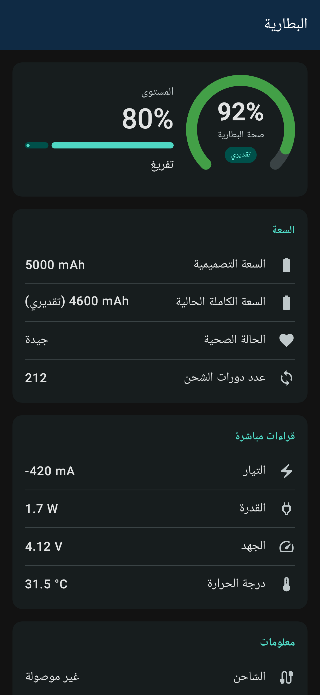
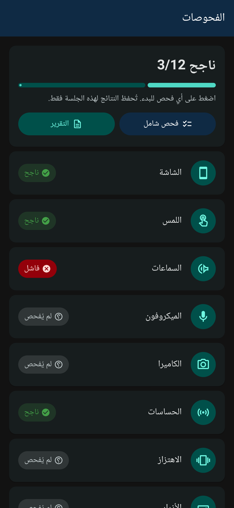
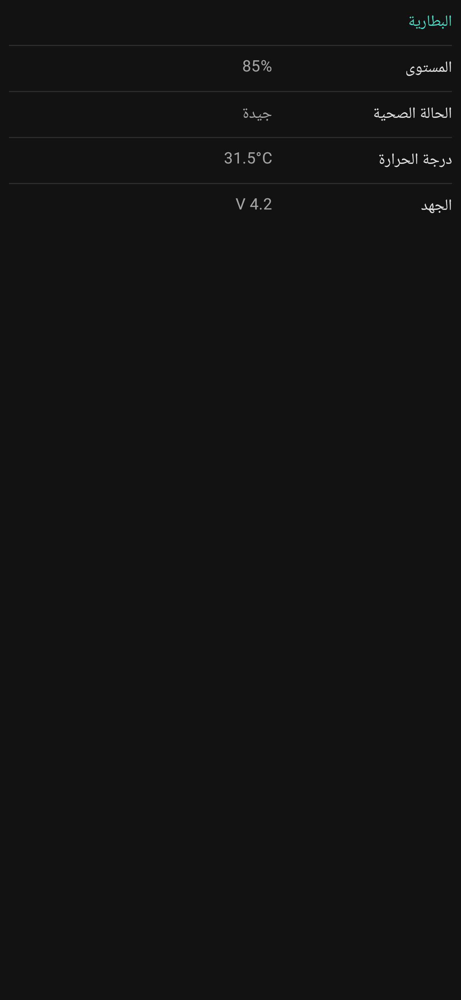
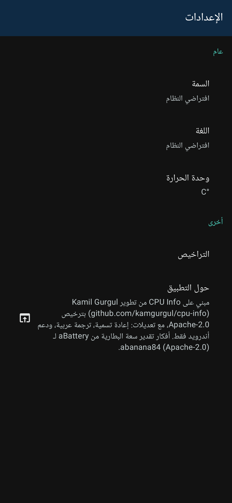

# فاحص الجوال (Mi5G Check)

**افحص جوالك بالكامل — العتاد، صحة البطارية، والشاشة واللمس والسماعات والميكروفون والكاميرا — في تطبيق عربي واحد بدون إعلانات.**

| البطارية | الفحوصات | العتاد | حول |
|:---:|:---:|:---:|:---:|
|  |  |  |  |

## المزايا

- **معلومات العتاد والنظام:** المعالج (مع الاسم التجاري للشريحة)، الذاكرة، التخزين، الشاشة، الحساسات، الشبكة، الكاميرات، إصدار أندرويد.
- **صحة البطارية:** السعة التصميمية، السعة الكاملة الحالية ونسبة الصحة (**قيم تقديرية ومُعلَّمة بكلمة «تقديري»**)، عدد الدورات عند توفره، والتيار والقدرة والجهد والحرارة مباشرة. ما لا يوفره الجهاز يظهر «غير متاح».
- **فحوصات العتاد:** الشاشة (بكسلات ميتة/عالقة)، اللمس، السماعات (الخارجية وسماعة المكالمات)، الميكروفون، الكاميرا (الأمامية والخلفية)، الحساسات (التسارع، الجيروسكوب، القرب، الإضاءة بقيم مباشرة)، الاهتزاز، أزرار الصوت، الفلاش، الاتصال (واي فاي، بلوتوث، GPS بدون إنترنت)، البصمة، الشحن (القدرة بالواط ونوع الشاحن، «شحن سريع» تقديري فوق ~15 واط).
- **فحص شامل وتقرير:** زر «فحص شامل» يمر على جميع الفحوصات بالترتيب (مع إمكانية التخطي) ثم يعرض تقريرًا بطراز الجهاز وإصدار أندرويد وصحة البطارية (تقديرية) ونتيجة كل فحص والتاريخ، ويمكن مشاركته كصورة PNG أو ملف PDF. يُنشأ التقرير على الجهاز ويُشارك فقط ولا يُرفع إلى أي مكان.
- الحرارة، التطبيقات المثبتة، الوضع الداكن/الفاتح، العربية (افتراضيًا) والإنجليزية.

## التحميل

حمّل أحدث ملف APK من صفحة الإصدارات: **[أحدث إصدار](https://github.com/al3nkboot/mi5g-check/releases/latest)**

## الأذونات

| الإذن | السبب |
|---|---|
| `CAMERA` | فحص الكاميرا فقط (معاينة، لا تُحفظ صور). |
| `RECORD_AUDIO` | فحص الميكروفون (تسجيل 3 ثوانٍ في الذاكرة ثم تشغيله، لا يُحفظ). |
| `MODIFY_AUDIO_SETTINGS` | توجيه نغمة الفحص إلى سماعة المكالمات. |
| `VIBRATE` | فحص الاهتزاز. |
| `ACCESS_FINE_LOCATION`، `ACCESS_COARSE_LOCATION` | فحص GPS فقط (يُطلب عند الضغط على «فحص GPS»؛ عرض الأقمار وتحديد الموقع، لا يُحفظ الموقع ولا يُرسل). |
| `BLUETOOTH` (أندرويد 11 وأقدم) | معرفة إن كان البلوتوث مفعّلًا في فحص الاتصال. |
| `USE_BIOMETRIC`، `USE_FINGERPRINT` (من مكتبة androidx.biometric) | فحص البصمة عبر نافذة النظام؛ التطبيق لا يرى البصمة. |
| `QUERY_ALL_PACKAGES`، `GET_PACKAGE_SIZE`، `REQUEST_DELETE_PACKAGES` | قائمة التطبيقات وأحجامها وإمكانية إلغاء تثبيت تطبيق بطلبك. |
| `KILL_BACKGROUND_PROCESSES` | إيقاف عمليات تطبيق في الخلفية بطلبك. |
| `ACCESS_NETWORK_STATE`، `ACCESS_WIFI_STATE`، `READ_BASIC_PHONE_STATE` | عرض معلومات الشبكة والواي فاي والشريحة في صفحة العتاد. |
| `READ_GSERVICES` | عرض معرّف خدمات Google في صفحة النظام (يُعرض محليًا فقط). |

## الخصوصية

التطبيق **لا يطلب إذن الإنترنت (`INTERNET`) أصلًا**، ولا يحتوي على أي مكتبات تتبع أو تحليلات أو إعلانات. كل المعلومات تُقرأ وتُعرض على جهازك فقط ولا تُرسل إلى أي مكان. (رابط «حول التطبيق» يفتح المتصفح فقط.)

## الشكر والترخيص

مبني على [CPU Info](https://github.com/kamgurgul/cpu-info) من تطوير Kamil Gurgul، ويستخدم طرق تقدير البطارية من [aBattery](https://github.com/abanana84/abattery) لـ abanana84 — وكلاهما بترخيص Apache-2.0. هذا المشروع أيضًا بترخيص [Apache-2.0](LICENSE)؛ انظر [NOTICE](NOTICE).

---

# Mi5G Check

**Check your whole phone — hardware, battery health, screen, touch, speakers, mic and camera — in one ad-free app, Arabic-first.**

## Features

- **Hardware & system info:** CPU (with SoC marketing name), RAM, storage, display, sensors, network, cameras, Android version.
- **Battery health:** design capacity, current full capacity and health % (**estimated values, clearly labelled “estimated”**), cycle count when available, plus live current, power, voltage and temperature. Anything the device doesn't expose shows “N/A”.
- **Hardware tests:** screen (dead/stuck pixels), touch, speakers (loudspeaker and earpiece), microphone, camera (front and rear), sensors (live accelerometer, gyroscope, proximity, light), vibration, volume buttons, flashlight, connectivity (Wi-Fi, Bluetooth, GPS without internet), fingerprint, charging (watts and charger type, “fast charging” estimated above ~15 W).
- **Full test & report:** “Full test” walks through every test in order (skip allowed), then shows a report with device model, Android version, battery health (estimated), each test result and the date. Share it as a PNG image or a PDF. The report is generated on-device and only shared by you; nothing is uploaded.
- Temperatures, installed apps, dark/light theme, Arabic (default) and English.

## Download

Get the latest APK from **[the latest release](https://github.com/al3nkboot/mi5g-check/releases/latest)**.

## Permissions

| Permission | Why |
|---|---|
| `CAMERA` | Camera test only (live preview, nothing is saved). |
| `RECORD_AUDIO` | Microphone test (3 s recording kept in memory and played back, never saved). |
| `MODIFY_AUDIO_SETTINGS` | Route the test tone to the earpiece. |
| `VIBRATE` | Vibration test. |
| `ACCESS_FINE_LOCATION`, `ACCESS_COARSE_LOCATION` | GPS test only (asked when you tap “Test GPS”; shows satellites/fix, location is never stored or sent). |
| `BLUETOOTH` (Android 11 and older) | Show whether Bluetooth is on in the connectivity test. |
| `USE_BIOMETRIC`, `USE_FINGERPRINT` (from androidx.biometric) | Fingerprint test via the system prompt; the app never sees your fingerprint. |
| `QUERY_ALL_PACKAGES`, `GET_PACKAGE_SIZE`, `REQUEST_DELETE_PACKAGES` | Apps list, sizes, and uninstalling an app when you ask. |
| `KILL_BACKGROUND_PROCESSES` | Stop an app's background processes when you ask. |
| `ACCESS_NETWORK_STATE`, `ACCESS_WIFI_STATE`, `READ_BASIC_PHONE_STATE` | Show network, Wi-Fi and SIM info on the Hardware page. |
| `READ_GSERVICES` | Show the Google Services Framework ID on the OS page (displayed locally only). |

## Privacy

The app **does not request the `INTERNET` permission at all** and contains no tracking, analytics or ad libraries. Everything is read and shown on your device and never sent anywhere. (The About link just opens your browser.)

## Credits & license

Based on [CPU Info](https://github.com/kamgurgul/cpu-info) by Kamil Gurgul, with battery estimation methods from [aBattery](https://github.com/abanana84/abattery) by abanana84 — both Apache-2.0. This project is licensed under [Apache-2.0](LICENSE); see [NOTICE](NOTICE).
